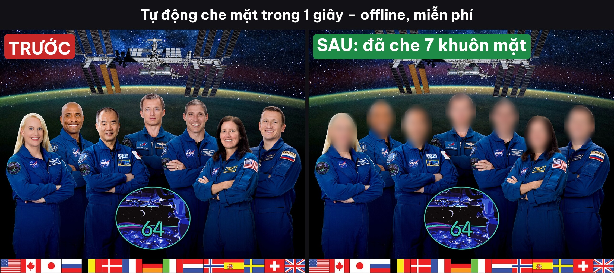
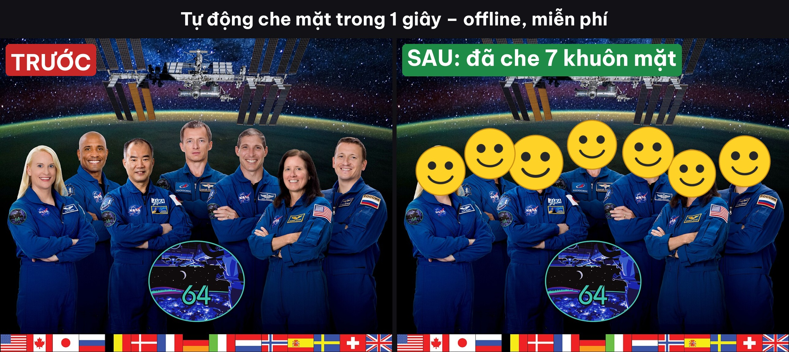

# anmat – Ẩn mặt tự động trong 1 giây

Chụp ảnh nhóm, quay video ngoài đường muốn đăng lên mạng nhưng **không muốn lộ mặt người lạ**? `anmat` tự tìm **mọi khuôn mặt** trong ảnh hoặc video rồi che lại (làm mờ, pixel, hộp đen hoặc mặt cười) – chạy **offline trên máy bạn**, miễn phí, không upload ảnh lên đâu cả.



| Pixel | Mặt cười |
|---|---|
|  |  |

## Tính năng

- Nhận diện khuôn mặt bằng mạng nơ-ron nhỏ (~230KB) của OpenCV, tự tải ở lần chạy đầu; không có mạng thì tự chuyển sang bộ dò Haar có sẵn.
- 4 kiểu che: `mo` (mờ elip viền mềm), `pixel`, `den` (hộp đen), `emoji` (mặt cười).
- Xử lý **ảnh, video, hoặc cả thư mục** một lần.
- Tuỳ chọn xuất **ảnh so sánh TRƯỚC / SAU** có chữ tiếng Việt – đăng mạng xã hội luôn.
- Video: giữ vùng che thêm 1 khung khi mất dấu để không bị "lộ mặt" chớp nhoáng.

## Cài đặt

```bash
git clone https://github.com/vietphan98/anmat.git
cd anmat
python -m venv .venv
source .venv/bin/activate      # Windows: .venv\Scripts\activate
pip install -r requirements.txt
```

## Cách dùng

```bash
# Làm mờ mặt trong 1 ảnh + xuất ảnh so sánh trước/sau
python -m anmat examples/phi-hanh-doan.jpg --so-sanh

# Đổi kiểu che
python -m anmat anh.jpg --kieu pixel
python -m anmat anh.jpg --kieu emoji

# Che mặt trong video
python -m anmat clip.mp4 --kieu mo

# Cả thư mục, lưu kết quả sang thư mục khác
python -m anmat thu_muc_anh/ --ra ket_qua/ --so-sanh
```

| Tuỳ chọn | Ý nghĩa |
|---|---|
| `--kieu` | `mo` / `pixel` / `den` / `emoji` (mặc định `mo`) |
| `--le` | Nới rộng vùng che quanh mặt, mặc định `0.25` |
| `--do-manh` | Độ mạnh làm mờ / độ to ô pixel, mặc định `1.0` |
| `--nguong` | Ngưỡng tin cậy nhận diện 0–1, mặc định `0.6` (hạ xuống nếu sót mặt nhỏ) |
| `--so-sanh` | Xuất thêm file `*_truoc_sau.jpg` |
| `--ra` | Thư mục lưu kết quả |

Kết quả được lưu cạnh file gốc với hậu tố `_anmat`.

## Demo quay Reel (20–30 giây)

1. Mở ảnh nhóm `examples/phi-hanh-doan.jpg` cho người xem thấy 7 gương mặt rõ nét.
2. Gõ lệnh `python -m anmat examples/phi-hanh-doan.jpg --kieu emoji --so-sanh` – terminal báo "7 mặt, 0.06s".
3. Mở `phi-hanh-doan_truoc_sau.jpg`: bên trái mặt rõ, bên phải 7 mặt cười che kín.
4. Chạy lại với `--kieu mo` và `--kieu pixel` để đổi kiểu trong vài giây.

**Câu hook gợi ý cho Reel:** "Đăng ảnh nhóm mà sợ lộ mặt người lạ? Một dòng lệnh, 0,1 giây, che sạch mọi khuôn mặt – không cần app trả phí!"

## Giới hạn

- Mặt quay nghiêng quá, bị che một nửa hoặc quá nhỏ có thể bị sót – hãy hạ `--nguong` hoặc kiểm tra lại trước khi đăng.
- Video xuất ra không có tiếng (OpenCV không ghi âm thanh); có thể ghép tiếng lại bằng FFmpeg.

## Ghi công

- Model nhận diện khuôn mặt YuNet thuộc [OpenCV Zoo](https://github.com/opencv/opencv_zoo) (giấy phép MIT), được tải về lúc chạy, không đi kèm repo.
- Ảnh mẫu là ảnh chân dung phi hành đoàn của NASA (phạm vi công cộng – public domain), lấy từ Wikimedia Commons.

## Giấy phép

MIT © 2026 Viet Phan
